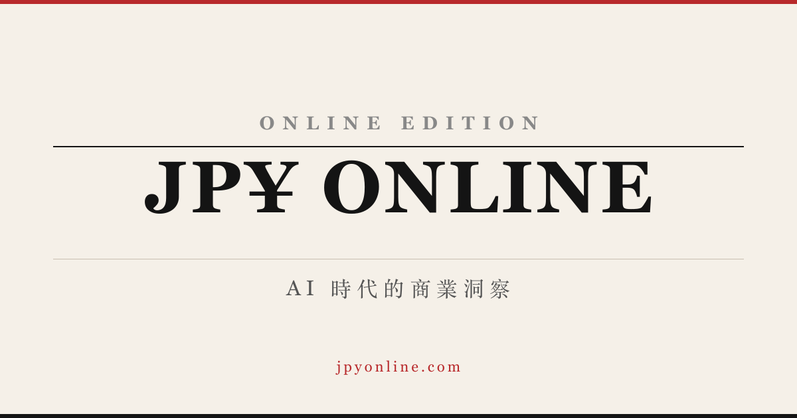

# 視覺識別：平成報紙風

[← 品牌](README.md) ・ [回到首頁](../../README.md)

## 設計定錨

日系平成風 × 商業報紙 × 黑白調。參考對象是日本平成年代的商業雜誌與經濟報紙：不用霓虹、漸層與花俏陰影，靠細線、留白與字體建立秩序。

## 色彩

| 角色 | 色彩 | 用法 |
|---|---|---|
| 主色 | 黑、白 | 文字、細線、框 |
| 底色 | 米白紙感 | 模擬報紙紙張 |
| 強調色 | 朱色 `#B8292B` | 印章紅，只作一點綴 |

## 字體

| 角色 | 字體 |
|---|---|
| 標題 | 明朝體（Noto Serif TC／Shippori Mincho） |
| 內文 | Noto Sans TC |

## 版面語法

- 細黑線分隔、細框
- 英文小型大寫眉標，例如 MACRO、BIZ REPO
- 日期顯眼
- 留白充足；文章閱讀欄寬約 720px，寬表格可延伸到主欄
- 頭版頭條加文章列表的報紙式首頁

## 封面插畫

每篇文章的封面都是一張極簡插畫，從文章裡抽出 1–3 個抽象概念來畫。

- 扁平、幾何、低彩度的同色系配色
- 滿版構圖
- 畫面不放任何文字
- 不畫國旗與地圖剪影，不做書本樣機、3D 立體或木板質感

## 品牌素材

| 素材 | 說明 |
|---|---|
| [`assets/banner.png`](../../assets/banner.png) | 品牌主視覺，1200×630，也是社群分享預設圖 |
| 品牌手冊 v1.0（2026-04-22） | 定位、色彩系統、字體、版面與網格、內容與語氣、影像處理六章，另附設計代碼對照 |
